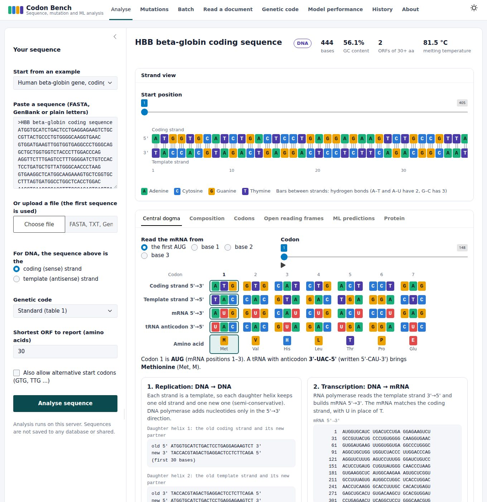
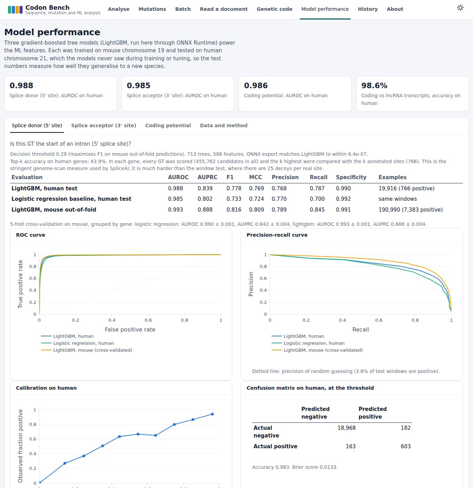
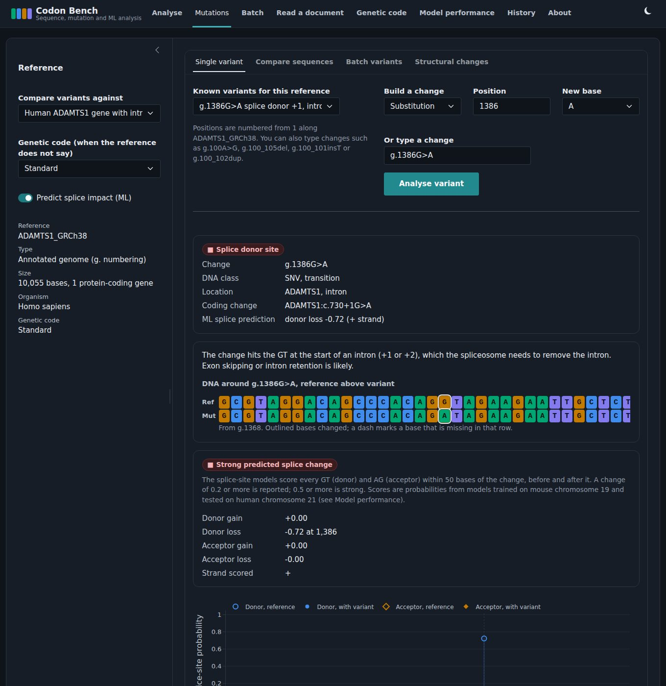
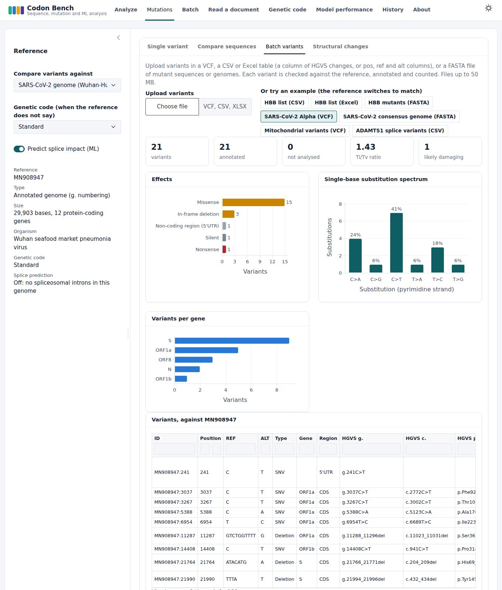
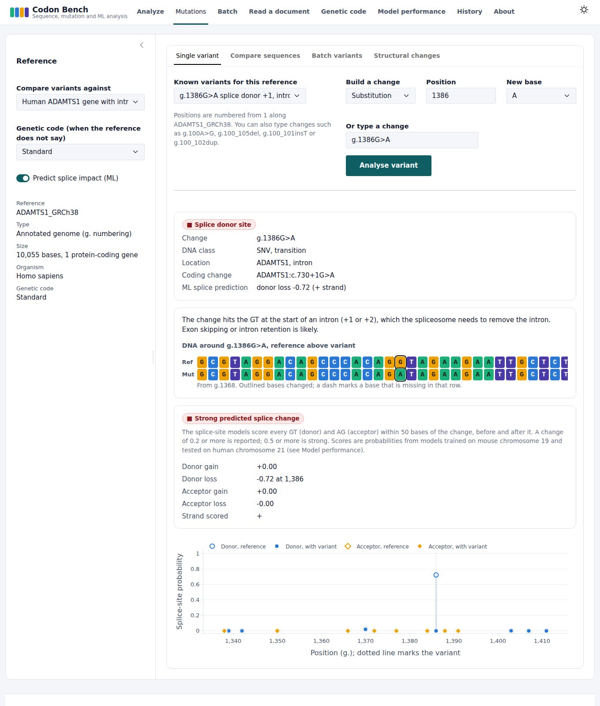

# Codon Bench

**Sequence, mutation and machine-learning analysis for DNA, RNA and proteins.**

I built Codon Bench to bring the things I kept doing by hand into one place: checking what a sequence is, following it through transcription and translation, and working out what a mutation does to the gene and the protein. It is a Shiny for Python web app. You can paste a sequence or upload a file, annotate variants against the genome of any organism, and use machine-learning models I trained to predict splice sites and protein-coding regions.

My background is medical laboratory science. In the lab I saw haemoglobin variants such as HbS and HbC as bands on an electrophoresis strip. In this app you can see the same variants at the level of the DNA and the protein.

Onipayede John Kwaku, AI/ML in Bioinformatics. MIT licence.



## Machine-learning models

I trained three LightGBM models on mouse chromosome 19 (GRCm39, GENCODE M31) and tested them once on human chromosome 21 (GRCh38, GENCODE). The human data played no part in training or tuning, so the test shows how well the models carry over to a new species rather than how well they remember what they were shown.

| Model (human test set) | AUROC | AUPRC | F1 | MCC | Logistic regression baseline, AUROC / AUPRC | Top-k accuracy, whole-gene scan |
|---|---|---|---|---|---|---|
| Splice donor (1 real site per 26 candidates) | 0.988 | 0.839 | 0.778 | 0.769 | 0.985 / 0.802 | 43.9% |
| Splice acceptor (1 per 26) | 0.985 | 0.813 | 0.730 | 0.719 | 0.981 / 0.766 | 38.3% |
| Coding potential, 150-base windows (balanced) | 0.986 | 0.974 | 0.935 | 0.872 | 0.981 / 0.971 | n/a |

Whole human transcripts, coding sequences against lncRNAs: accuracy 98.6%, AUROC 1.000 (142 transcripts, 30 coding; a small set, so read the AUROC with care).

Top-k accuracy is the hardest test here, the one SpliceAI reports. In each gene I score every GT or AG and compare the k highest with the k annotated sites. My models read about 400 bases around each site. Deep models that read 10,000 bases do much better on this measure, and closing that gap is the next thing I want to work on.

I never used the human set for fitting, early stopping or choosing thresholds. I did score it twice: once for a first version, and again after I added flanking-context features. I made that change because it raised the mouse cross-validated AUPRC (donor 0.85 to 0.89), not because of the human result.

The models run inside the app through ONNX Runtime, so the server does not need LightGBM installed. The scripts in `training/` rebuild everything from the raw data with fixed seeds and checksums. The **Model performance** page shows ROC and precision-recall curves, calibration, confusion matrices, feature importance, and a comparison of what the splice models learned with the known splice-site consensus.



## What the app does

| Page | Purpose |
|---|---|
| **Analyse** | Detects DNA, RNA or protein; shows both strands with hydrogen bonds; walks codon by codon through replication, transcription, translation (with tRNA anticodons) and reverse transcription; reports composition, GC content, melting temperature, codon usage, six-frame ORFs and protein properties. The **ML predictions** tab scores coding potential along the sequence and every candidate splice site, and each ORF gets a coding probability. |
| **Mutations** | Annotates variants against a coding sequence, an unannotated sequence or an annotated GenBank genome of any organism, in HGVS c., g., m. and p. notation, with each gene's own genetic code. Covers silent, missense, nonsense, stop-loss, start-loss, frameshift, in-frame insertion and deletion, duplication, inversion, splice-site, splice-region, intronic, UTR and intergenic changes. Every variant in a eukaryotic nuclear gene also gets an ML splice-impact score. Single variants, sequence or genome comparison, batches, and structural changes (inversion, translocation with its fusion protein, duplication, deletion). |
| **Batch** | Many sequences at once from FASTA, TXT, GenBank, CSV, TSV or Excel, gzip included. |
| **Read a document** | Reads sequences from photos, scans and PDFs with OCR, classifies every line and lets you correct the result. |
| **Genetic code** | Codon wheel for five genetic codes with anticodons, and the nitrogenous bases. |
| **Model performance** | Full evaluation of the three models. |
| **History** | Everything analysed in the session, downloadable as CSV. |
| **About** | What the app does, its inputs and its limits. |

The app has a light and a dark theme (it follows your system setting until you switch) and works on phones.





### Mutation analysis across fields

| Built-in reference | Example use |
|---|---|
| Human beta-globin (HBB) coding sequence | Haemoglobinopathies: HbS c.20A>T p.Glu7Val (traditionally Glu6Val), HbC, beta-thalassaemia codon 39 and codons 41/42 |
| Human ADAMTS1 gene with introns | Splice-site, splice-region and intronic variants with c.N+k notation and ML splice impact |
| Human mitochondrial genome (rCRS) | m.3243A>G (MELAS), m.11778G>A (LHON), haplogroup markers; genetic code 2; genes on both strands |
| SARS-CoV-2 Wuhan-Hu-1 | Lineage-defining mutations such as S:D614G, S:N501Y and the S:H69-V70 deletion, from a VCF or a consensus genome |
| Your own | Any FASTA or GenBank file: bacteria, plants, plasmids, viruses, organelles or single genes |



### Accepted inputs

| Type | Formats | Size limit |
|---|---|---|
| Sequences | FASTA (.fasta, .fa, .fna, .faa), GenBank (.gb, .gbk, .gbff), plain text, CSV, TSV, Excel, and any of these gzipped | 50 MB |
| Variants | VCF, CSV or Excel (an `hgvs` column, or `pos`, `ref` and `alt` columns), FASTA of mutant sequences or genomes | 50 MB |
| Documents | PNG, JPG, TIFF, BMP, WEBP images; PDF | 10 MB images, 20 MB PDFs |

The app checks each file by its contents, not just its name. It refuses ordinary text, unrelated tables, images renamed as sequence files, binary files and oversized files, and says why. The limits are set in `codonbench/config.py`.

## Project structure

```
codon-bench/
├── app.py                        Shiny app: layout, pages and server logic
├── requirements.txt              runtime dependencies (pinned)
├── codonbench/                   the analysis package
│   ├── config.py                 name, version, author details, upload limits
│   ├── seq.py                    sequence detection, central dogma, ORFs, composition, protein properties
│   ├── files.py                  file checks and streaming FASTA, CSV and Excel readers
│   ├── batch.py                  many-sequence analysis
│   ├── docread.py                OCR and document understanding
│   ├── mutations.py              HGVS parsing and normalisation, effect prediction, alignment, translocation
│   ├── genome.py                 references of any organism, VCF, variant annotation, genome comparison
│   ├── ml.py                     feature extraction and ONNX inference for the three models
│   ├── mutations_ui.py           Mutations page
│   ├── mutation_views.py         effect cards, aligned sequences, chromosome diagrams
│   ├── performance_ui.py         Model performance page
│   ├── viz.py                    colour palette, sequence graphics and charts
│   └── demos.py                  built-in example sequences
├── models/                       trained ONNX models, model card and evaluation curves
├── training/                     download, dataset building and training scripts, processed test datasets
├── data/
│   ├── samples/                  example files for every input type (see data/README.md)
│   └── training_samples/         small samples of the ML datasets
├── scripts/make_samples.py       regenerates the sample files
├── www/                          stylesheet, theme script and Plotly.js
├── docs/                         About page text and screenshots
├── tests/                        pytest suite
├── CITATION.cff, LICENSE
```

## Run locally

Python 3.11 or 3.12.

```bash
git clone https://github.com/onipayedejohn/codon-bench.git
cd codon-bench
python -m venv .venv
source .venv/bin/activate          # Windows: .venv\Scripts\activate
pip install -r requirements.txt
shiny run app.py                   # then open http://127.0.0.1:8000
```

Tests: `pip install pytest` then `pytest -q`.

## Hosting

The app runs on Posit Connect Cloud with `app.py` as the entry point. It used about 350 MB of memory in my tests after reading a photo with OCR. Sequence and variant files are streamed, and the three models take about 4 MB on disk. If OpenCV cannot load on a server, the document page reports that OCR is unavailable and everything else keeps working.

## How I checked it

- The HBB coding sequence translates exactly to UniProt P68871. HbS, HbC and the beta-thalassaemia variants come out with their published names.
- All 21 SARS-CoV-2 changes in the sample VCF (Alpha-defining mutations and inherited B.1 and B.1.1 markers) give the published amino-acid changes. The one difference is the spike Y144 deletion, which HGVS's 3' rule names p.Tyr145del because residues 144 and 145 are both tyrosine. Comparing the constructed consensus genome with the reference recovers all 21.
- The mitochondrial variants give the published protein changes, including the minus-strand gene MT-ND6 (m.14484T>C, p.Met64Val) under genetic code 2. Alternative start codons (MT-ND2 starts with ATT) and stop codons completed by the poly-A tail (MT-CO3 and others) are handled.
- I went through the biology and the HGVS naming rules case by case (3' shifting of indels, duplications, frameshift stop counting, stop-loss and start-loss) and turned each case into a test in `tests/`.

## Limits

- Codon Bench is a research tool, not a clinical or diagnostic tool. Its predictions are not evidence of pathogenicity.
- Effects are predicted from sequence. Protein structure, regulation, population frequency and clinical significance are not assessed.
- The splice models read about 400 bases around each site, so they miss long-range signals that deep models such as SpliceAI use.
- The human test set is part of one chromosome. Results on other species and other genes can differ.
- OCR can misread a letter, so check sequences read from images against the original.

## Citation

> Onipayede, J. K. (2026). *Codon Bench: sequence, mutation and machine-learning analysis for DNA, RNA and proteins* (Version 2.0.0) [Software]. https://github.com/onipayedejohn/codon-bench

See `CITATION.cff`.

## Licence

MIT. © 2026 Onipayede John Kwaku.
